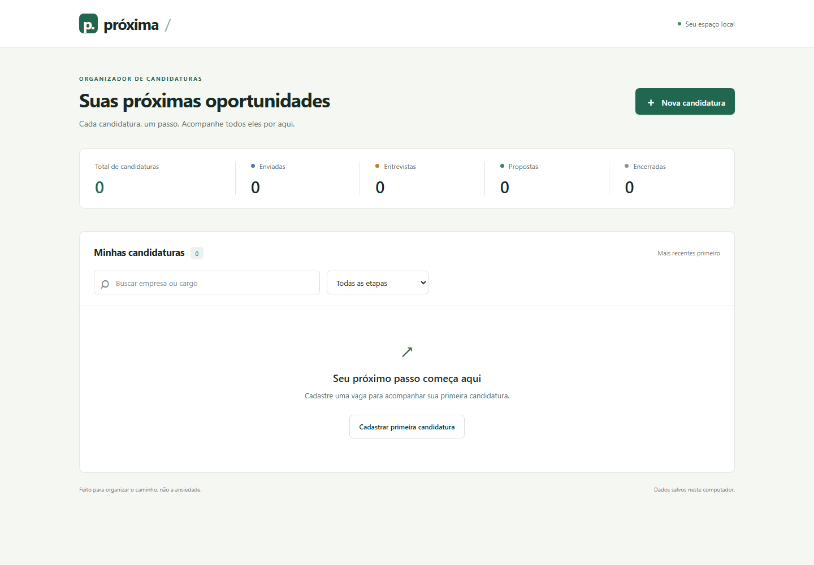

# Organizador de candidaturas

Aplicação pessoal de portfólio para acompanhar candidaturas a vagas, com interface em português, busca por empresa/cargo, filtro de etapa e resumo geral. O objetivo é praticar Java, HTTP, SQL e testes em um projeto pequeno que funciona de ponta a ponta, sem depender de serviços externos.



## Funcionalidades

- Cadastro, edição e exclusão com confirmação.
- Etapas: enviada, entrevista, proposta e encerrada.
- Busca por empresa ou cargo e filtro por etapa.
- Resumo global, datas, links e observações.
- Interface responsiva, navegação por teclado e mensagens de validação.
- Modo escuro pelo botão de sol/lua no cabeçalho; acompanha o sistema até uma escolha manual e salva a preferência no navegador.
- Banco SQLite local persistente, sem conta ou serviços externos.

[Modo escuro](docs/dark-mode.png) · [Modo escuro no celular](docs/dark-mobile.png)


[Formulário no desktop](docs/formulario.png) · [Formulário no celular](docs/mobile.png)


## Requisitos

- JDK 21 ou superior; o projeto compila com `release 21`.
- Maven 3.9 ou superior no PATH.
- Navegador atualizado.
- Node.js 24 apenas para os testes do frontend; não é necessário para executar o JAR.

Backend: Spring Boot 3.5.7, Spring Web, Bean Validation, Spring JDBC e SQLite JDBC 3.50.3.0. Não utiliza JPA nem servidor de banco separado.

## Executar no Windows

Na pasta do projeto, em PowerShell:

```powershell
mvn.cmd clean verify
java -jar target/organizador-candidaturas-1.0.0.jar
```

Em Git Bash:

```bash
mvn.cmd clean verify
java -jar target/organizador-candidaturas-1.0.0.jar
```

No Linux/macOS, use `mvn clean verify`. Se o launcher `mvn` falhar no Git Bash do Windows, prefira `mvn.cmd`. Quando necessário, informe o caminho completo do Maven; por exemplo, no PowerShell:

```powershell
& 'C:/Users/Usuario/Tools/apache-maven-3.9.16/bin/mvn.cmd' clean verify
```

Abra **http://127.0.0.1:8080**. O próprio Spring Boot serve `src/main/resources/static/index.html` e os módulos JavaScript; não abra o HTML diretamente como arquivo. Encerre com Ctrl+C. Para desenvolvimento também é possível usar `mvn.cmd spring-boot:run`.

### Porta e banco

PowerShell:

```powershell
$env:PORT = '8081'
$env:DB_PATH = 'C:/Users/Usuario/candidaturas/dados.db'
java -jar target/organizador-candidaturas-1.0.0.jar
```

Git Bash:

```bash
PORT=8081 DB_PATH='C:/Users/Usuario/candidaturas/dados.db' java -jar target/organizador-candidaturas-1.0.0.jar
```

`PORT` é opcional e assume `8080`. `DB_PATH` é opcional e assume `./data/candidaturas.db`, relativo à pasta em que o processo é iniciado. As pastas necessárias são criadas automaticamente. Para copiar o banco como backup, encerre a aplicação antes e guarde o arquivo `.db` em local seguro. Não apague o arquivo se quiser preservar os dados. Testes não usam esse banco.

## API

Todos os campos usam nomes em português. POST e PUT aceitam JSON com este formato; `id` é gerado pelo servidor:

```json
{
  "empresa": "Acme",
  "cargo": "Desenvolvedor Java Júnior",
  "link": "https://example.com/vaga",
  "dataCandidatura": "2025-01-10",
  "etapa": "ENVIADA",
  "observacoes": "Enviar portfólio na próxima conversa"
}
```

| Campo | Regra |
| --- | --- |
| empresa | Obrigatória, não vazia, máximo 150 caracteres; espaços externos removidos |
| cargo | Obrigatório, não vazio, máximo 150 caracteres; espaços externos removidos |
| link | Opcional, máximo 1000 caracteres, URL absoluta HTTP/HTTPS com host e sem credenciais; vazio vira null |
| dataCandidatura | Obrigatória, data válida AAAA-MM-DD, hoje ou passado segundo a data local do servidor |
| etapa | Obrigatória: ENVIADA, ENTREVISTA, PROPOSTA ou ENCERRADA |
| observacoes | Opcional, máximo 5000 caracteres |

| Método e rota | Retorno |
| --- | --- |
| GET /api/candidaturas | 200, array simples de candidaturas; vazio retorna [] |
| GET /api/candidaturas?etapa=ENVIADA&busca=java | Filtros combinados; busca literal parcial em empresa ou cargo, sem diferenciar maiúsculas/minúsculas |
| GET /api/candidaturas/{id} | 200, candidatura; 404 se inexistente |
| POST /api/candidaturas | 201, candidatura criada, incluindo id numérico e cabeçalho Location |
| PUT /api/candidaturas/{id} | 200, candidatura substituída integralmente; 404 se inexistente |
| DELETE /api/candidaturas/{id} | 204 sem corpo; 404 se inexistente |
| GET /api/resumo | 200, total global e contagem de todas as etapas, independentemente dos filtros |

Cada candidatura retornada tem exatamente `id`, `empresa`, `cargo`, `link`, `dataCandidatura`, `etapa` e `observacoes`. Opcionais não informados retornam null. A lista é ordenada por data da candidatura decrescente e, em empate, id decrescente. Busca não remove acentos. Resumo vazio:

```json
{
  "total": 0,
  "porEtapa": {"ENVIADA": 0, "ENTREVISTA": 0, "PROPOSTA": 0, "ENCERRADA": 0}
}
```

JSON inválido, datas, etapa ou parâmetros inválidos e validação de campos retornam 400. Erros tratados da API usam `mensagem` e `erros` (array de strings):

```json
{
  "mensagem": "Revise os campos informados",
  "erros": ["empresa: Informe a empresa"]
}
```

Recurso inexistente retorna 404 com `{"mensagem":"Candidatura não encontrada","erros":[]}`. Mutações rejeitadas por origem retornam 403 no mesmo formato.

## Testes

```powershell
mvn.cmd test
mvn.cmd clean verify
```

Os testes de integração exercitam HTTP com MockMvc e SQLite real em arquivos isolados dentro de `target/test-data`, incluindo CRUD, filtros, resumo, validação, entradas semelhantes a SQL injection, persistência, criação de pastas e bloqueio de mutações entre origens. A inicialização do repositório não apaga dados existentes. O build gera `target/organizador-candidaturas-1.0.0.jar`.

Para testes do frontend, instale Node.js 24, depois:

```bash
npm ci
npx playwright install chromium
npm test
```

Para os testes de navegador, execute o servidor em outro terminal com um banco descartável, sem seus dados pessoais:

```bash
PORT=8080 DB_PATH='./target/e2e-local.db' java -jar target/organizador-candidaturas-1.0.0.jar
```

Equivalente PowerShell:

```powershell
$env:PORT = '8080'
$env:DB_PATH = './target/e2e-local.db'
java -jar target/organizador-candidaturas-1.0.0.jar
```

Com o servidor ativo em http://127.0.0.1:8080:

```bash
npm run test:e2e
```

Os testes de navegador criam e excluem registros; não os execute contra um banco de uso pessoal. Em máquinas Linux/CI, o Playwright pode exigir `npx playwright install --with-deps chromium`. O workflow em `.github/workflows/ci.yml` executa a verificação Java e os testes do frontend.

Em JDKs recentes, SQLite e a infraestrutura de testes podem emitir avisos de acesso nativo/agentes. Eles não representam falha dos testes; JDK 21 é o alvo de compilação.

## Organização

- `CandidaturaController`: rotas REST, entrada validada e filtro de busca.
- `CandidaturaInput`: regras dos dados recebidos e validação de links.
- `CandidaturaRepository`: SQL parametrizado com JdbcTemplate e inicialização da tabela.
- `ResumoController`: contagens globais por etapa.
- `ApiExceptionHandler`: mensagens de erro em português.
- `LocalOriginFilter`: proteção adicional contra mutações de outra origem no navegador.
- `src/main/resources/static`: frontend servido junto com a API, sem build obrigatório.
- `src/test/java`: testes de integração sem banco pessoal ou mocks do banco.

## Privacidade e limitações

A configuração padrão escuta somente em **127.0.0.1**, sem autenticação, CORS liberado ou sincronização em nuvem. Todas as rotas e métodos aceitam apenas hosts `localhost` ou `127.0.0.1`; outros hosts recebem 403 para bloquear DNS rebinding, inclusive em leituras e arquivos estáticos. Mutações com Origin diferente da origem do servidor, ou Sec-Fetch-Site cross-site, são rejeitadas. Ferramentas locais sem Origin continuam permitidas. Essa verificação não substitui autenticação e não protege contra outros processos ou usuários com acesso à máquina. O banco não é criptografado; mantenha permissões e backups adequados. A aplicação não consulta automaticamente os links cadastrados; abrir uma vaga no navegador acessa o site externo escolhido.

Não exponha a aplicação à internet ou à rede local nem coloque atrás de um proxy público. É uma ferramenta pessoal, não um produto multiusuário. A busca e o resumo carregam os registros em memória, sem paginação; isso é adequado para o escopo pequeno, mas não para grandes volumes. Não há anexos, importação de currículos, notificações, recuperação automática de backups ou migrações versionadas de esquema. Mudanças futuras de estrutura exigem planejamento de migração antes de usar um banco existente.
